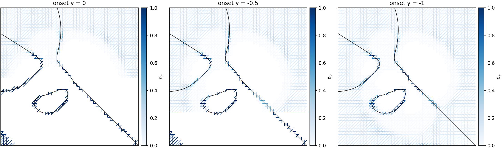
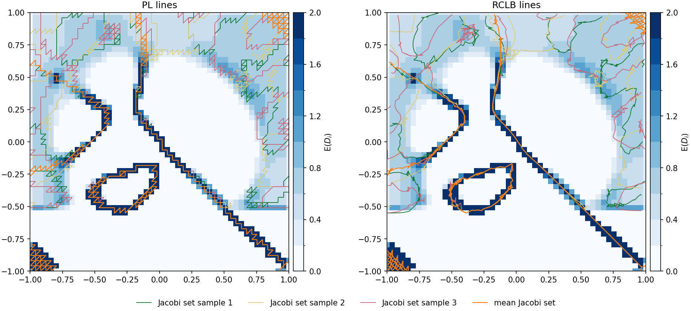

<h1 align="center">Uncertainty-Aware Jacobi Set Computation</h1>


## ✨ Overview
This repository provides the code for **Uncertainty-Aware Jacobi Set Computation** by Klötzl and Weiskopf [[1]](#1).
For two uncertain scalar fields, modeled jointly as a multivariate Gaussian, it computes the probability that an edge belongs to their piecewise linear Jacobi set [[2]](#2), analytically and without sampling.

The content is as follows:

    │
    ├── uncertainty_aware_jacobi_set
    │   ├── jacobi.py       # Core of the method (Algorithm 1)
    │   ├── models.py       # Uncertainty models from ensembles or kernels
    │   ├── vis.py          # Visualizations
    │   ├── bilinear.py     # Optional local bilinear Jacobi set lines [3, 4]
    │   └── ...
    ├── figures             # Figures of the demo
    └── demo.ipynb          # Main demo


## ⚙️ Usage
This code was tested with Python 3.11 and can be installed via

```bash
pip install -r requirements.txt
pip install -e .
```

Main functionality can be accessed via the function `jacobi.compute`:

```Python
import uncertainty_aware_jacobi_set as uajs

geo = uajs.geometry.build_geometry(x1d, y1d)               # triangulated grid
pair = uajs.FieldPair.from_ensemble(members_f, members_g)  # members of shape (E, ny, nx)
res = uajs.jacobi.compute(geo, pair)
```

For two fields on a grid with coordinates `x1d` and `y1d`, it returns the Jacobi set edge probabilities (`res["p_edge"]`), their aggregation to the vertices (`res["expected_degree"]`, `res["signed_degree"]`), and the Jacobi set of the mean fields (`res["mean_crit"]`).

A demo is given in `demo.ipynb`, using the analytic dataset of the paper with a kernel-based uncertainty model. The results are as follows:






## 📖 References
<a id="1">[1]</a>
Klötzl, D. and Weiskopf, D.
Uncertainty-Aware Jacobi Set Computation
In: IEEE Workshop on Uncertainty Visualization (2026), to appear

<a id="2">[2]</a>
Edelsbrunner, H. and Harer, J.
Jacobi sets of multiple Morse functions
In: Foundations of Computational Mathematics, pp. 37&ndash;57, 2002
[https://doi.org/10.1017/CBO9781139106962.003]

<a id="3">[3]</a>
Klötzl, D., Krake, T., Zhou, Y., Hotz, I., Wang, B. and Weiskopf, D.
Local Bilinear Computation of Jacobi Sets
The Visual Computer 38(9&ndash;10), 3435&ndash;3448 (2022)
[https://doi.org/10.1007/s00371-022-02557-4]

<a id="4">[4]</a>
Klötzl, D., Krake, T., Zhou, Y., Stober, J., Schulte, K., Hotz, I., Wang, B. and Weiskopf, D.
Reduced Connectivity for Local Bilinear Jacobi Sets
In: Topological Data Analysis and Visualization (TopoInVis), IEEE (2022)
[https://doi.org/10.1109/topoinvis57755.2022.00011]


## 📄 Citation
If you use this code, please cite the accompanying paper:

```bibtex
@inproceedings{Kloetzl2026,
  author    = {Kl{\"o}tzl, Daniel and Weiskopf, Daniel},
  booktitle = {IEEE Workshop on Uncertainty Visualization},
  title     = {Uncertainty-Aware {J}acobi Set Computation},
  year      = {2026},
  note      = {To appear},
}
```


## 👤 Author
**Daniel Klötzl**

- Github: [@VisDan93](https://github.com/visdan93)


## 🪪 License
Copyright 2026 Daniel Klötzl

Licensed under the Apache License, Version 2.0 (the "License"); you may not use this file except in compliance with the License. You may obtain a copy of the License at

<http://www.apache.org/licenses/LICENSE-2.0>

Unless required by applicable law or agreed to in writing, software distributed under the License is distributed on an "AS IS" BASIS, WITHOUT WARRANTIES OR CONDITIONS OF ANY KIND, either express or implied. See the License for the specific language governing permissions and limitations under the License.
